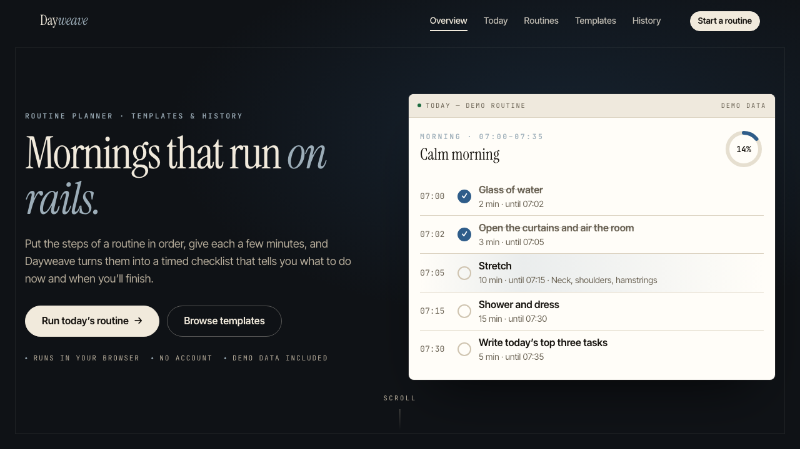
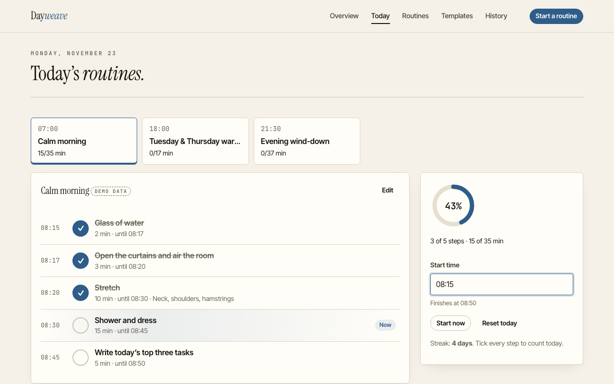
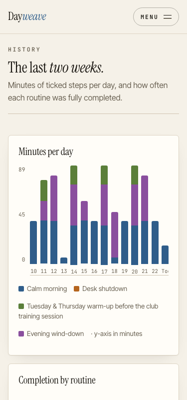

# Dayweave

A routine planner that turns an ordered list of steps into a timed checklist. It shows the clock time of each step and what to do now, and tracks completion, streaks and minutes over two weeks.

**Live demo:** [https://dayweave-routines.vercel.app/](https://dayweave-routines.vercel.app/) — runs entirely in your browser; demo data is fictional and labelled.



| Today | Mobile history |
| --- | --- |
|  |  |

## Run it

```bash
npm install
npm run dev        # http://localhost:5201
npm test
npm run build
npm run test:e2e   # Playwright smoke test (npm run e2e:install once if Chromium is missing)
```

## Main workflow

1. The app opens with three labelled **demo routines** and 13 days of history. One routine has a very long name, and today’s morning routine is two steps in.
2. **Today** → choose a routine. Each step shows its start time; tick steps as you go, and the next one is highlighted. Change the start time, or press **Start now**, and every time shifts.
3. **Routines** → a sortable table with length, 14-day completion and streak. **New routine** opens the editor: name, time of day, start time, then steps with minutes and notes, reordered with ↑/↓ buttons.
4. **Templates** → five starting points (calm morning, evening wind-down, workout warm-up, weekly reset, study block). Using one copies it and opens it for editing.
5. **History** → stacked minutes-per-day chart for 14 days (legend, axis, tooltips on hover and keyboard focus) and a per-routine completion strip.

## Rules

- Steps run back to back from the start time; times wrap past midnight.
- A day counts as **complete** only when every current step is ticked. Ticks on steps you later delete are ignored.
- The **streak** counts consecutive complete days ending today, or yesterday if today isn’t finished yet.
- **14-day completion** = complete days ÷ 14.
- Validation: a name, a 24-hour start time, at least one step, and step lengths of 1–240 whole minutes. Errors update live after the first save attempt.

## Design

Shared editorial system with Instrument Serif display type, Inter Tight interface text, mono time labels, an ink hero whose preview is the real checklist component, and a warm paper workspace. Motion (staggered hero, progress ring, rising bars, scroll reveals, route cross-fades) is disabled under `prefers-reduced-motion`.

## Tests

- `src/lib/routines.test.ts` — time parsing and wrapping, scheduling, reordering bounds, validation, templates, run toggling, deleted-step ticks, streaks, history, minutes per day.
- `src/App.test.tsx` — demo state, completing a routine, empty state, editor validation and reordering, templates, history chart.
- `e2e/smoke.spec.ts` — landing, tick and re-time, reload persistence, build and reorder a routine, history, plus 375px layout checks.

## Limitations

- No reminders, alarms or timers that run in the background.
- Routines don’t have weekday schedules; every routine appears every day.
- History reflects the routine’s current steps, so editing a routine changes how past days are scored.

## Future improvements

- Weekday schedules per routine, and an optional countdown timer for the current step.

## Licence

MIT — see [LICENSE](LICENSE).
